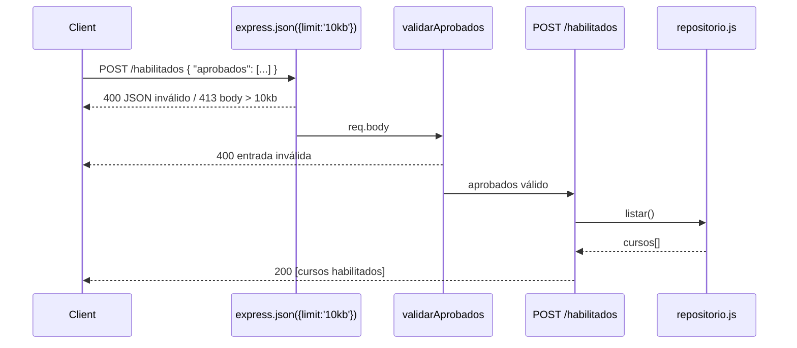
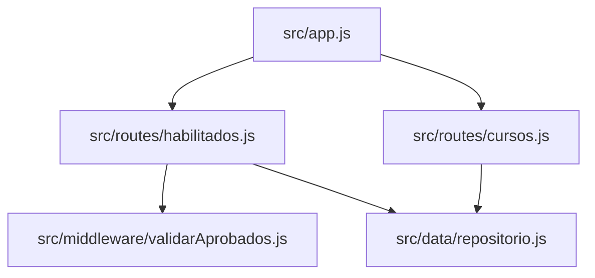

# Design Document: habilitados

## Overview

Diseño técnico del endpoint `POST /habilitados` del servicio Malla INF, de las correcciones de seguridad derivadas de los hallazgos del prototipo anterior y de los gates del pipeline definidos en `requirements.md`.

El endpoint recibe la lista de cursos aprobados (`aprobados`) y devuelve los cursos del catálogo no aprobados cuyos requisitos están todos en esa lista. El servicio es Node.js 22 + Express 4; los datos se cargan una vez desde `data/cursos.json` mediante `src/data/repositorio.js`.

## Architecture





## Components and Interfaces

### 1. `src/middleware/validarAprobados.js`

Middleware `validarAprobados(req, res, next)`. Cada paso corta con 400 y `{ "error": "<mensaje>" }`; el mensaje nunca repite el valor recibido (req. 4.3).

1. `req.body` debe ser un objeto y tener el campo `aprobados` (req. 2.2).
2. `aprobados` debe ser un `Array` (req. 2.1).
3. `aprobados.length` ≤ 100 (req. 3.1).
4. Cada elemento debe ser `string` (req. 4.1).
5. Cada elemento debe ser no vacío y cumplir `/^[0-9][A-Z]{3}[0-9]{2}$/` (req. 4.2, 4.3).

> **Decisión:** la validación va en su propio archivo para testearla aislada y no mezclarla con el cálculo.

### 2. `src/routes/habilitados.js`

`POST /` montado en `/habilitados`. Tras la validación:

1. `const aprobados = new Set(req.body.aprobados)`.
2. `repositorio.listar()`.
3. Filtra cursos con `!aprobados.has(curso.id)` y `curso.prerequisites.every(p => aprobados.has(p))`.
4. Ordena por `id` ascendente y proyecta a `{ id, name, credits, cycle, type }`.
5. Responde 200.

Complejidad O(cursos × requisitos) ≈ 87 × pocos; con el límite de 100 elementos el tiempo es acotado (req. 3.3).

### 3. `src/app.js`

- `app.use(express.json({ limit: '10kb' }))`.
- `app.use('/habilitados', require('./routes/habilitados'))` después de `/cursos`.
- Middleware de errores al final (ver Error Handling).

### 4. `.github/workflows/ci.yml`

Jobs `test` (con cobertura), `sca`, `secrets` y `sast`. Detalle en **Gates del pipeline**.

## Data Models

### Request

```json
{ "aprobados": ["1INF25", "1INF27", "1INF49"] }
```

| Campo | Tipo | Restricciones |
|---|---|---|
| `aprobados` | `string[]` | Obligatorio, 0–100 elementos, cada uno cumple `/^[0-9][A-Z]{3}[0-9]{2}$/` |

### Response 200

Mismo contrato de curso que `GET /cursos`:

```json
[
  { "id": "1INF29", "name": "Sistemas Operativos", "credits": 2.5, "cycle": 6, "type": "obligatorio" }
]
```

### Response 4xx / 5xx

```json
{ "error": "aprobados debe ser un arreglo" }
```

## Decisiones del endpoint (casos no definidos en el pedido)

| Caso | Decisión | Razón |
|---|---|---|
| Código con formato válido pero inexistente (ej. `9ZZZ99`) | Se ignora; responde 200 | No es un ataque ni altera el cálculo; rechazarlo obligaría al alumno a limpiar su lista por cursos retirados del plan. |
| `aprobados: []` | 200 con los cursos sin requisitos | Corresponde a un alumno que inicia el ciclo 5; el pedido indica que un curso sin requisitos está habilitado. |
| Códigos duplicados | Se aceptan; se deduplican con `Set` | Repetir un aprobado no cambia el resultado; rechazarlo no aporta seguridad. |
| Códigos en minúscula (`1inf25`) | 400 | Los códigos del catálogo están en mayúscula; normalizar ocultaría errores del cliente y amplía la superficie de entrada. |
| Campos extra en el body | Se ignoran | No afectan el cálculo; el contrato solo exige `aprobados`. |
| Forma de la respuesta | `[{id, name, credits, cycle, type}]` | Un solo contrato de curso en toda la API, igual a `GET /cursos`. |
| Orden de la respuesta | `id` ascendente | Respuesta determinista y fácil de verificar en tests. |
| Tamaño del body | `express.json({ limit: '10kb' })`; si se excede, 413 | 100 códigos ocupan ~1 KB; corta el abuso del hallazgo 1 antes de parsear. |
| Límite de elementos | 100 | El catálogo tiene 87 cursos; 100 deja margen y rechaza la entrada de 5 000. |

## Error Handling

| Escenario | HTTP | Body |
|---|---|---|
| Falta `aprobados` o no es arreglo | 400 | `{ "error": "aprobados debe ser un arreglo de códigos" }` |
| Más de 100 elementos | 400 | `{ "error": "aprobados admite como máximo 100 códigos" }` |
| Elemento no string, vacío o con formato inválido | 400 | `{ "error": "código de curso inválido" }` |
| JSON malformado | 400 | `{ "error": "JSON inválido" }` |
| Body > 10 kb | 413 | `{ "error": "solicitud demasiado grande" }` |
| Excepción no controlada | 500 | `{ "error": "Internal server error" }` |

```javascript
// eslint-disable-next-line no-unused-vars
app.use((err, req, res, next) => {
  if (err.type === 'entity.parse.failed') {
    return res.status(400).json({ error: 'JSON inválido' });
  }
  if (err.type === 'entity.too.large') {
    return res.status(413).json({ error: 'solicitud demasiado grande' });
  }
  return res.status(500).json({ error: 'Internal server error' });
});
```

Ninguna respuesta incluye `err.message`, `err.stack` ni rutas del servidor (hallazgo 2).

## Gates del pipeline

| Gate | Herramienta y umbral | Bloquea / avisa | Etapa | Razón |
|---|---|---|---|---|
| Cobertura (req. 6) | Jest `coverageThreshold.global.lines = 80`, `jest --coverage` | **Bloquea** | Pull request y push a `main` | Política de TI: la cobertura de líneas no baja de 80 %. Correr en PR evita que llegue código sin probar a `main`. |
| SCA (req. 7) | `npm audit --audit-level=high` | **Bloquea** con high/critical; moderate/low solo se reportan en el log | Pull request y push a `main` | Política de TI: ninguna dependencia high/critical. En PR se detecta antes del merge; en `main` detecta advisories nuevos publicados después del merge. No se bloquea por moderate/low para no frenar entregas por avisos sin explotación conocida. |
| Secretos (req. 8) | gitleaks (`gitleaks/gitleaks-action@v2`), umbral: 0 hallazgos, historial completo (`fetch-depth: 0`) | **Bloquea** | Pull request y push a `main` | Política de TI: ningún secreto en el repositorio. Un secreto en el historial sigue expuesto aunque se borre en un commit posterior, por eso se escanea todo el historial. Una clave rotada o un falso positivo se registra en `.gitleaksignore` con su razón. |
| SAST (extra) | CodeQL (`github/codeql-action`, lenguaje `javascript`) | **Avisa** (publica alertas en Security, no falla el job) | Pull request y push a `main` | Detecta patrones como XSS reflejado o rutas inseguras del hallazgo 2. Avisa en lugar de bloquear porque es una herramienta nueva en el equipo y sus falsos positivos aún no están calibrados; se pasará a bloquear severidad high cuando se tenga una línea base. |

> **Decisión:** no se agregan dependencias nuevas (se descartó `fast-check` propuesto inicialmente). `tech.md` exige justificar cada dependencia y cada una amplía la superficie que revisa el gate de SCA; los tests de ejemplo con supertest cubren cada criterio.

## Testing Strategy

Jest + supertest sobre `src/app.js`, sin levantar el servidor. Al menos un test por criterio de aceptación en `tests/habilitados.test.js`.

| Req. | Test |
|---|---|
| 1.1, 1.5 | `["1INF25","1INF27","1INF49"]` → 200, 27 cursos, incluye 1INF29, 1INF30, 1INF31, 1INF32 |
| 1.2 | Ningún curso devuelto tiene un requisito fuera de `aprobados` |
| 1.3 | Ningún curso devuelto está en `aprobados` |
| 1.4 | `[]` → todos los cursos devueltos tienen `prerequisites` vacío en el catálogo |
| 2.1 | `{"aprobados":"1INF25"}`, `123`, `null`, `{}` → 400 con `error` |
| 2.2 | `{}` → 400 |
| 2.3 | JSON malformado → 400; `Content-Type: text/plain` → 400 |
| 3.1 | 101 elementos → 400; 5 000 elementos → 400 o 413 |
| 3.2 | 100 elementos válidos → 200 |
| 3.3 | 100 elementos responde en < 500 ms |
| 4.1 | `[123]` → 400 |
| 4.2 | `[""]` → 400 |
| 4.3 | `["1INF30<script>"]` → 400 y el body no contiene `<script>` |
| 5.1 | En todos los 4xx el body solo tiene `error` y no contiene `at `, `\`, `/src/` |
| 5.2 | `jest.spyOn(repositorio, 'listar').mockImplementation(() => { throw new Error('boom') })` → 500 `{"error":"Internal server error"}` |
| 6–8 | Verificados por los jobs del pipeline (evidencia en `TRAZABILIDAD.md`) |